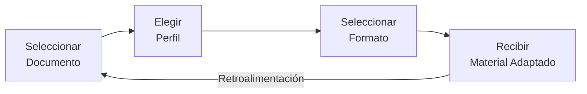
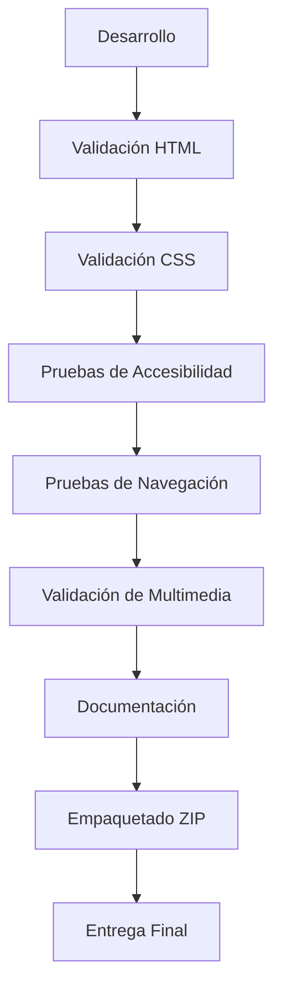

# Renaissance HTML5 Edition

> **Transformar documentación compleja en conocimiento accesible**

*Proyecto académico para la E-Actividad 2.1 - Diseño web con HTML, Curso FrontEndIVIVFI2026C, Universidad Valle del Momboy (UVM)*

---

## 🏆 Insignias

| Categoría | Insignia |
|-----------|--------|
| **HTML5** |  |
| **CSS3** |  |
| **Semántica HTML** |  |
| **Diseño Responsive** |  |
| **Accesibilidad** |  |
| **Static Site** |  |
| **Sin Dependencias** |  |
| **UVM** |  |
| **E-Actividad** |  |
| **Documentación** |  |

---

## 📖 Tabla de Contenidos

- [Renaissance HTML5 Edition](#renaissance-html5-edition)
- [🏆 Insignias](#-insignias)
- [📖 Tabla de Contenidos](#-tabla-de-contenidos)
- [📘 Introducción](#-introducción)
- [📌 Origen del proyecto y alcance académico](#-origen-del-proyecto-y-alcance-académico)
- [🎨 Sistema de Diseño Visual](#-sistema-de-diseño-visual)
- [🏗️ Arquitectura del Proyecto](#-arquitectura-del-proyecto)
- [✨ Funcionalidades Implementadas](#-funcionalidades-implementadas)
- [🔍 Accesibilidad y Semántica](#-accesibilidad-y-semántica)
- [🚀 Comenzando](#-comenzando)
- [✅ Validación](#-validación)
- [📁 Estructura de Archivos](#-estructura-de-archivos)
- [📊 Matriz de Funcionalidades](#-matriz-de-funcionalidades)
- [📚 Documentación Académica](#-documentación-académica)
- [🎯 Roadmap](#-roadmap)
- [👤 Autor y estudiante responsable](#-autor-y-estudiante-responsable)
- [📜 Licencia](#-licencia)
- [📅 Entrega](#-entrega)

---

## 📘 Introducción

**Renaissance HTML5 Edition** es un proyecto académico estático que demuestra el uso avanzado de **HTML5 semántico** y **CSS3** para crear una experiencia web educativa de alta calidad. El proyecto ilustra cómo transformar documentación técnica compleja en conocimiento accesible a través de una estructura clara, semántica y adaptada a diferentes perfiles de aprendizaje.

### 🎯 Propósito

El objetivo principal es cumplir con los requisitos de la **E-Actividad 2.1** del curso **FrontEndIVIVFI2026C** de la **Universidad Valle del Momboy (UVM)**, demostrando:

- Uso correcto de HTML5 semántico
- Implementación de CSS3 original sin frameworks
- Diseño responsive y accesible
- Integración de elementos multimedia con accesibilidad
- Navegación funcional entre músltiples páginas
- Documentación técnica completa

### 📌 Origen del proyecto y alcance académico

**Renaissance HTML5 Edition** es una adaptación académica independiente inspirada en **NuevaMente**, una iniciativa de tecnología educativa orientada a transformar documentación técnica compleja en experiencias de aprendizaje accesibles y personalizadas.

La iniciativa original dispone de un repositorio de desarrollo y un prototipo interactivo:

- **Proyecto original:** [NuevaMente G10 LATAM — GitHub](https://github.com/mmorfe-engineer/nuevamente_g10_latam)
- **Prototipo interactivo:** [NuevaMente — Streamlit](https://nuevamenteg10latam-jnpaufeq4dzeyq6qw4spds.streamlit.app)

#### Una adaptación diseñada para la evaluación

Esta edición fue desarrollada específicamente para la **E-Actividad 2.1 — Diseño web con HTML**, de la Universidad Valle del Momboy (UVM).

En lugar de trasladar la arquitectura completa de NuevaMente, se optó por construir una implementación estática, independiente y deliberadamente acotada, centrada en los fundamentos de HTML5: estructura semántica, navegación, formularios, tablas, elementos multimedia y accesibilidad.

Esta separación responde a una decisión técnica y académica: **cumplir rigurosamente el pliego de condiciones de la evaluación sin introducir complejidad innecesaria, preservando al mismo tiempo la calidad visual, la coherencia conceptual y las buenas prácticas de desarrollo frontend.**

Por ello, esta edición no incorpora procesamiento real de documentos, servicios de inteligencia artificial ni backend. Los formularios y flujos presentados tienen una finalidad demostrativa.

Renaissance HTML5 Edition constituye una implementación educativa autónoma, con un alcance claramente definido y una identidad visual inspirada en NuevaMente.

Para explorar la iniciativa más allá del alcance académico, pueden consultarse el repositorio original y el prototipo interactivo mediante los enlaces anteriores.

---

## 🎨 Sistema de Diseño Visual

El sistema de diseño de Renaissance HTML5 Edition está inspirado en el concepto editorial premium, con una estética clara, cálida y accesible.

### 🎨 Paleta de Colores

| Variable CSS | Color | Uso |
|--------------|-------|-----|
| `--color-canvas` |  `#FCFCF9` | Fondo general (papel cálido) |
| `--color-surface` |  `#FFFFFF` | Superficie principal de tarjetas |
| `--color-surface-alt` |  `#F4F4F1` | Superficie secundaria |
| `--color-ink` |  `#111110` | Texto y títulos principales |
| `--color-ink-muted` |  `#555552` | Texto de lectura y subtítulos |
| `--color-ink-faint` |  `#999995` | Metadatos y rotulación tenue |
| `--color-brand` |  `#2E5C8A` | Acento azul institucional |
| `--color-brand-subtle` |  `#E6F0FA` | Tinte azul sutil |
| `--color-brand-strong` |  `#1A3A5C` | Azul oscuro |
| `--color-source` |  `#6B4C9A` | Violeta para fuentes y citas |
| `--color-source-subtle` |  `#F3EEFA` | Tinte violeta sutil |

### 🔤 Tipografía

| Variable CSS | Familia | Uso |
|--------------|---------|-----|
| `--font-ui` | `'Inter', system-ui, -apple-system, BlinkMacSystemFont, 'Segoe UI', Roboto, sans-serif` | Interfaz de usuario, botones, formularios |
| `--font-editorial` | `'Lora', Georgia, 'Times New Roman', serif` | Títulos, encabezados, texto destacable |

### 📏 Espaciado

Basado en sistema de 4px:
- `--spacing-4`: 0.25rem (4px)
- `--spacing-8`: 0.5rem (8px)
- `--spacing-12`: 0.75rem (12px)
- `--spacing-16`: 1rem (16px)
- `--spacing-24`: 1.5rem (24px)
- `--spacing-32`: 2rem (32px)
- `--spacing-48`: 3rem (48px)
- `--spacing-64`: 4rem (64px)

### 🎯 Filosofía de Diseño

- **Claridad:** Prioridad máxima a la legibilidad
- **Consistencia:** Uso coherente de colores, tipografía y espaciado
- **Accesibilidad:** Contraste WCAG AA/AAA, navegación por teclado
- **Responsive:** Adaptación perfecta a todos los dispositivos
- **Premium:** Apariencia editorial de alta calidad

---

## 🏗️ Arquitectura del Proyecto

El proyecto sigue una arquitectura simple y efectiva de sitio web estático:

### 📁 Estructura de Directorios

```
renaissance-html5-uvm-e2/
├── index.html              # Página principal con información del proyecto
├── explorar.html           # Laboratorio con formulario, tabla y multimedia
├── css/
│   └── styles.css         # Estilos CSS originales con variables y responsive
├── assets/
│   ├── images/
│   │   ├── educational-workflow.png  # Diagrama de flujo educativo (PNG)
│   │   └── github-logo.jpg           # Logotipo de GitHub
│   ├── audio/
│   │   └── html5-semantico.mp3     # Narración sobre HTML5 Semántico
│   └── video/
│       ├── flujo-educativo.mp4      # Video explicativo del flujo
│       └── flujo-educativo.es.vtt    # Subtítulos en español
└── docs/
    ├── ARQUITECTURA.md      # Documentación de arquitectura
    ├── VALIDACION.md        # Resultados de validación
    ├── RUBRICA.md           # Matriz de cumplimiento
    ├── GUIA_VIDEO.md        # Guía para presentación
    └── ENTREGA.md           # Instrucciones de entrega
```

### 🔄 Flujo de Navegación

```mermaid
flowchart TD
    A[index.html] -->|Link "Comenzar a Explorar"| B[explorar.html]
    B -->|Link "Volver a Inicio"| A
    B -->|Enlace interno| B
```

### 🧱 Anatomía Semántica de la Página

```mermaid
block-beta
    columns 1
    block:header:8
        columns 1
        div["rn-header-container"]
        block:nav
            ul
            li
            a
        end
    end
    block:main:24
        columns 1
        section["Hero"]
        section["Introducción"]
        article
        section["Proceso"]
        ol["Flujo de Trabajo"]
        section["Perfiles"]
        section["Formularios"]
        section["Tabla"]
        table
        section["Multimedia"]
        figure
        audio
        video
    end
    block:footer:8
        columns 1
        footer-container
    end
```

### 🎓 Flujo Educativo Conceptual



### ✅ Proceso de Validación Académica



---

## ✨ Funcionalidades Implementadas

### 📄 Páginas HTML

| Página | Descripción | Elementos Clave |
|-------|-------------|----------------|
| `index.html` | Página principal con presentación del proyecto | header, nav, main, section, article, ol, li, figure, figcaption |
| `explorar.html` | Laboratorio de demostración HTML5 | form, fieldset, legend, label, input, select, textarea, table, caption, thead, tbody, th, td, audio, video, track, details, summary |

### 🎨 CSS

- **Variables CSS:** Sistema completo de tokens de diseño (colores, tipografía, espaciado)
- **Mobile-first:** Diseño responsive con media queries
- **Grid y Flexbox:** Layouts modernos y flexibles
- **Estados interactivos:** Hover, focus, focus-visible
- **Accesibilidad:** Estados de foco visibles, contraste adecuado
- **Reduced motion:** Soporte para `prefers-reduced-motion`
- **Print-friendly:** Estilos para impresión

### 🎵 Multimedia

| Recurso | Archivo | Formato | Descripción |
|---------|---------|---------|-------------|
| Imagen | `educational-workflow.png` | PNG | Diagrama de flujo educativo (1448×1086) |
| Audio | `html5-semantico.mp3` | MP3 | Narración sobre HTML5 Semántico (2:30 min) |
| Video | `flujo-educativo.mp4` | MP4 (H.264/AAC) | Video explicativo del flujo (720×1280, vertical) |
| Subtítulos | `flujo-educativo.es.vtt` | WebVTT | Subtítulos en español |

### 🔗 Navegación

- Navegación principal entre `index.html` y `explorar.html`
- Enlaces internos con fragment identifiers (`#proceso`, `#perfiles`, `#formulario`, `#tabla`, `#multimedia`)
- Navegación por teclado completa
- Estados de foco visibles

### ♿ Accesibilidad

- Textos alternativos (`alt`) en todas las imágenes
- Etiquetas (`label`) asociadas a todos los controles de formulario
- Atributos `aria-` apropiados
- Estructura de tablas accesible con `scope`, `caption`, `thead`, `tbody`
- Subtítulos y transcripciones para multimedia
- Navegación por teclado completa
- Contraste de colores WCAG AA/AAA

---

## 🔍 Accesibilidad y Semántica

### 🏷️ Elementos Semánticos de HTML5 Utilizados

#### Estructura Básica

| Elemento | Uso | Beneficio |
|----------|-----|-----------|
| `<header>` | Cabecera de la página | Define el área de introducción |
| `<nav>` | Navegación principal | Agrupa enlaces de navegación |
| `<main>` | Contenido principal | Define el contenido úrcnico |
| `<footer>` | Pie de página | Área de información adicional |
| `<article>` | Contenido independiente | Define bloques de contenido autocontenido |
| `<section>` | Secciones temáticas | Agrupa contenido relacionado |

#### Contenido

| Elemento | Uso | Beneficio |
|----------|-----|-----------|
| `<h1>` a `<h6>` | Jerarquía de títulos | Estructura clara y accesible |
| `<p>` | Párrafos | Contenido textual semántico |
| `<ol>`, `<ul>`, `<li>` | Listas ordenadas/desordenadas | Estructura de ítems |
| `<figure>`, `<figcaption>` | Imágenes con subtítulos | Asociación de imagen y descripción |
| `<blockquote>` | Citas | Contenido citado |
| `<code>` | Código | Fragmentos de código |

#### Formularios

| Elemento | Uso | Beneficio |
|----------|-----|-----------|
| `<form>` | Contenedor de formulario | Agrupa campos relacionados |
| `<fieldset>` | Grupo de campos | Agrupa campos lógicamente |
| `<legend>` | Título de fieldset | Describe el grupo de campos |
| `<label>` | Etiquetas de campos | Asociación clara campo-etiqueta |
| `<input>` | Entrada de datos | Variedad de tipos y validación |
| `<select>`, `<option>` | Selección | Menús desplegables |
| `<textarea>` | Área de texto | Entrada de texto multilínea |
| `<button>` | Botones | Acciones interactivas |
| `<output>` | Salida | Mostrar resultados |
| `<small>` | Texto secundario | Ayuda contextual |

#### Tablas

| Elemento | Uso | Beneficio |
|----------|-----|-----------|
| `<table>` | Tabla de datos | Estructura tabular |
| `<caption>` | Título de tabla | Descripción de la tabla |
| `<thead>` | Cabecera de tabla | Define columnas |
| `<tbody>` | Cuerpo de tabla | Contenido de datos |
| `<th>` | Celda de encabezado | Encabezados de fila/columna |
| `<td>` | Celda de datos | Datos individuales |
| `scope="col"` / `scope="row"` | Ámbito de encabezado | Asociación accesible |

#### Multimedia

| Elemento | Uso | Beneficio |
|----------|-----|-----------|
| `<audio>` | Reproducción de audio | Contenido audio accesible |
| `<video>` | Reproducción de video | Contenido video accesible |
| `<source>` | Fuentes de multimedia | Músltiples formatos |
| `<track>` | Pistas de texto | Subtítulos y descripciones |
| `<figure>` | Contenedor multimedia | Asociación con figcaption |

#### Interactivos

| Elemento | Uso | Beneficio |
|----------|-----|-----------|
| `<details>` | Contenido plegable | Expansión/cierre de contenido |
| `<summary>` | Resumen de details | Título clickeable |

### 🎯 Justificación de la Semántica

El uso de HTML5 semántico es fundamental porque:

1. **Accesibilidad:** Los lectores de pantalla pueden navegar mejor por el contenido
2. **SEO:** Los motores de búsqueda entienden mejor la estructura y relevancia
3. **Mantenibilidad:** El código es más legible y comprensible
4. **Estándares:** Cumple con las mejores prácticas web
5. **Dispositivos:** Mejora la experiencia en dispositivos con limitaciones
6. **Indexación:** Facilita la indexación por parte de herramientas de búsqueda

### ♿ Defensas de Accesibilidad

#### Formularios

- **Etiquetas asociadas:** Todos los `<input>`, `<select>`, `<textarea>` tienen `<label>` asociado con `for` o anidamiento
- **Validación nativa:** Uso de atributos como `required`, `minlength`, `maxlength`, `min`, `max`, `step`
- **Ayuda contextual:** Uso de `<small>` con `aria-describedby` para descripciones adicionales
- **Agrupación:** Uso de `<fieldset>` y `<legend>` para agrupar campos relacionados
- **Accesibilidad por teclado:** Todos los controles son accesibles vía teclado

#### Tablas

- **Estructura clara:** Uso de `<thead>`, `<tbody>`, `<tfoot>` (cuando aplica)
- **Encabezados:** Todas las celdas de datos tienen encabezados asociados con `scope`
- **Título descriptivo:** `<caption>` en todas las tablas
- **Asociación visual:** Estilos que destacan la estructura

#### Imágenes

- **Textos alternativos:** Todas las imágenes tienen atributo `alt` descriptivo
- **Figuras:** Uso de `<figure>` y `<figcaption>` para contenido gráfico importante
- **Contexto:** Las imágenes están integradas en el flujo de contenido

#### Multimedia

- **Controles:** Todos los elementos `<audio>` y `<video>` tienen `controls`
- **Fuentes músltiples:** Uso de `<source>` para compatibilidad
- **Subtítulos:** `<track>` con subtítulos en WebVTT
- **Transcripciones:** Texto alternativo proporcionado para audio y video
- **Poster:** Imagen de poster para videos

#### Navegación

- **Enlaces descriptivos:** Textos de enlace claros y descriptivos
- **Atributos aria:** Uso de `aria-label`, `aria-current`, `aria-describedby`
- **Estructura semántica:** Uso de `<nav>`, `<ul>`, `<li>`, `<a>`
- **Estados de foco:** Estilos de foco visibles para navegación por teclado

---

## 🚀 Comenzando

### 💻 Requisitos

- Navegador web moderno (Chrome, Firefox, Safari, Edge)
- Conexión a internet (opcional, para fuentes de Google Fonts)
- No se requieren herramientas de desarrollo, npm, o servidores

### 📥 Instalación

1. **Clonar el repositorio** (si está publicado):
   ```bash
   git clone https://github.com/mmorfe-engineer/renaissance-html5-uvm-e2.git
   cd renaissance-html5-uvm-e2
   ```

2. **Descargar el ZIP** (alternativa):
   - Descargar el archivo ZIP del repositorio
   - Extraer en una carpeta local

### 🏃 Iniciar

Simplemente abre el archivo `index.html` en tu navegador web:

```bash
# En Linux/Mac
xdg-open index.html  # Linux
open index.html      # Mac

# En Windows
double click on index.html
```

O arrastra el archivo `index.html` directamente a tu navegador.

### 🧭 Navegar

- Haz clic en "Comenzar a Explorar" o "Ir a Explorar" para ir a la página de laboratorio
- Usa los enlaces de navegación en la cabecera para moverte entre secciones
- Prueba el formulario, la tabla y los elementos multimedia en la página Explorar
- Regresa a Inicio usando el botón "Volver a Inicio"

---

## ✅ Validación

### 📋 Validación HTML

Este proyecto puede ser validado usando las siguientes herramientas:

1. **W3C Validator (Nu HTML Checker)**:
   - URL: https://validator.w3.org/nu/
   - Comando local: `java -jar vnu.jar index.html`
   - Resultado: Consultar [docs/VALIDACION.md](docs/VALIDACION.md)

2. **Validación manual**:
   - Todos los documentos tienen doctype HTML5
   - Todos los documentos tienen `lang="es"`
   - Todos los documentos tienen charset UTF-8
   - Todos los documentos tienen viewport meta tag
   - Todos los documentos tienen títulos únicos y descriptivos
   - No hay IDs duplicados
   - Jerarquía de encabezados coherente (h1 > h2 > h3 > h4)
   - Anidamiento correcto de elementos
   - Todos los enlaces son relativos y funcionales
   - Todas las etiquetas están asociadas correctamente
   - Todos los atributos de formulario son válidos
   - Todas las tablas tienen caption y scope
   - Todas las imágenes tienen alt
   - Todos los elementos audio/video tienen sources
   - Subtítulos VTT válidos

### 🎨 Validación CSS

- Sintaxis CSS válida
- Variables CSS (Custom Properties) funcionan correctamente
- Media queries respondan a diferentes tamaños de pantalla
- No hay propiedades obsoletas
- Uso consistente de unidades (rem, px, %)

### ♿ Validación de Accesibilidad

- Contraste de colores: WCAG AA/AAA
- Navegación por teclado: Completa
- Estados de foco: Visibles
- Textos alternativos: Presentes y descriptivos
- Estructura semántica: Correcta
- Atributos aria: Apropiados

### 🔗 Validación de Enlaces

- Todos los enlaces internos funcionan
- Todos los enlaces de navegación funcionan
- Todos los enlaces de fragment identifiers funcionan
- No hay enlaces rotos
- No hay enlaces a recursos externos no verificados

### 📦 Validación de Multimedia

- SVG válido y bien formado
- VTT válido y sincronizado
- Archivos de audio/video referenciados existen
- Atributos de multimedia son correctos

Para detalles completos, consulta [docs/VALIDACION.md](docs/VALIDACION.md).

---

## 📁 Estructura de Archivos

```
renaissance-html5-uvm-e2/
├── index.html                    # 11.3 KB - Página principal
├── explorar.html                 # 20.6 KB - Laboratorio HTML5
├── css/
│   └── styles.css               # 19.3 KB - Estilos CSS
├── assets/
│   ├── images/
│   │   ├── educational-workflow.png  #  1.8 MB - Diagrama PNG (1448×1086)
│   │   └── github-logo.jpg           #    371 B - Logotipo de GitHub
│   ├── audio/
│   │   └── html5-semantico.mp3     #  1.1 MB - Audio MP3
│   │   └── README.txt              # Instrucciones
│   └── video/
│       ├── flujo-educativo.mp4      #  6.0 MB - Video MP4 (720×1280)
│       ├── flujo-educativo.es.vtt    #  0.7 KB - Subtítulos WebVTT
│       └── README.txt              # Instrucciones
├── docs/
│   ├── ARQUITECTURA.md            # Documentación de arquitectura
│   ├── VALIDACION.md              # Resultados de validación
│   ├── RUBRICA.md                 # Matriz de cumplimiento
│   ├── GUIA_VIDEO.md              # Guía para presentación
│   └── ENTREGA.md                 # Instrucciones de entrega
├── REFERENCIAS.md                 # Referencias bibliográficas
├── README.md                      # Este archivo
└── .gitignore                     # Exclusiones de Git
```

**Total aproximado:** ~25-30 MB (con archivos de audio/video reales)

---

## 📊 Matriz de Funcionalidades

| Requisito | Archivo | Elemento HTML | Estado | Evidencia |
|-----------|---------|---------------|--------|-----------|
| Al menos 2 archivos HTML | index.html, explorar.html | - | ✅ | Existen ambos archivos |
| HTML5 Doctype | index.html, explorar.html | `<!DOCTYPE html>` | ✅ | Primera línea de cada archivo |
| lang="es" | index.html, explorar.html | `<html lang="es">` | ✅ | Atributo lang |
| charset UTF-8 | index.html, explorar.html | `<meta charset="UTF-8">` | ✅ | Meta tag |
| Viewport meta tag | index.html, explorar.html | `<meta name="viewport">` | ✅ | Meta tag |
| Títulos únicos | index.html, explorar.html | `<title>` | ✅ | Títulos descriptivos |
| Estructura semántica | Todos | header, nav, main, footer | ✅ | Uso en ambas páginas |
| Encabezados jerárquicos | Todos | h1, h2, h3, h4 | ✅ | Jerarquía correcta |
| Párrafos | Todos | `<p>` | ✅ | Músltiples párrafos |
| Listas ordenadas | index.html, explorar.html | `<ol>`, `<li>` | ✅ | Flujo de trabajo, FAQ |
| Listas desordenadas | Todos | `<ul>`, `<li>` | ✅ | Navegación, FAQ |
| Navegación real | Todos | `<nav>`, `<a>` | ✅ | Links entre páginas |
| Formularios | explorar.html | `<form>`, `<fieldset>`, `<legend>`, `<label>`, `<input>`, `<select>`, `<textarea>`, `<button>` | ✅ | Formulario completo |
| Tablas | explorar.html | `<table>`, `<caption>`, `<thead>`, `<tbody>`, `<th scope>`, `<td>` | ✅ | Tabla comparativa |
| Imágenes | index.html, explorar.html | ``, `<figure>`, `<figcaption>` | ✅ | SVG y referencias |
| Audio | explorar.html | `<audio>`, `<source>` | ✅ | Elemento con controls |
| Video | explorar.html | `<video>`, `<source>`, `<track>` | ✅ | Elemento con subtítulos |
| CSS original | css/styles.css | - | ✅ | Archivo de 19.3 KB |
| Diseño responsive | styles.css | Media queries | ✅ | @media para mobile/tablet |
| Accessibility | Todos | aria-*, focus states | ✅ | Atributos y estilos |

---

## 📚 Documentación Académica

Este proyecto incluye documentación completa para cumplir con los requisitos académicos:

### 📄 Documentos en `docs/`

1. **[ARQUITECTURA.md](docs/ARQUITECTURA.md)**
   - Decisiones de arquitectura
   - Diagrama de archivos
   - Decisiones semánticas
   - Racional de diseño

2. **[VALIDACION.md](docs/VALIDACION.md)**
   - Entorno de pruebas
   - Comandos ejecutados
   - Resultados de validación
   - Limitaciones conocidas

3. **[RUBRICA.md](docs/RUBRICA.md)**
   - Matriz de cumplimiento completa
   - Mapeo de requisitos vs implementación
   - Bloqueadores (si los hay)

4. **[GUIA_VIDEO.md](docs/GUIA_VIDEO.md)**
   - Guía para presentación en video
   - Timeline con timestamps
   - Instrucciones de demostración

5. **[ENTREGA.md](docs/ENTREGA.md)**
   - Checklist de entrega
   - Instrucciones de empaquetado ZIP
   - Instrucciones de GitHub

### 📄 Documentos Raíz

1. **[REFERENCIAS.md](REFERENCIAS.md)**
   - Referencias bibliográficas en formato APA
   - Fuentes consultadas
   - Atribución de materiales

2. **README.md** (Este archivo)
   - Documentación completa del proyecto
   - Guía de uso
   - Información técnica

---

## 🎯 Roadmap

### ✅ Actual (E-Actividad 2.1)

- [x] Estructura HTML5 semántica
- [x] CSS3 original y responsive
- [x] Navegación entre páginas
- [x] Formularios con validación
- [x] Tablas accesibles
- [x] Elementos multimedia
- [x] Accesibilidad completa
- [x] Documentación completa

### 🚧 Futuro (No Implementado)

Los siguientes elementos **NO** son parte de esta actividad y **NO** están implementados:

- ❌ Base de datos
- ❌ Backend con Node.js
- ❌ Frameworks frontend (React, Vue, Angular, Svelte)
- ❌ Build tools (Webpack, Vite, Parcel)
- ❌ Processadores CSS (Sass, Less)
- ❌ API externa o AI
- ❌ Autenticación de usuarios
- ❌ Estado persistente
- ❌ Conexión a servicios externos

> ⚠️ **Nota:** Este proyecto es **100% estático** y demostrativo. No promete funcionalidades que no están implementadas.

---

## 👤 Autor y estudiante responsable

| Información | Detalle |
|----------------|---------|
| **Nombre** | Martin Morfe.* |
| **Institución** | Universidad Valle del Momboy |
| **Curso** | FrontEndIVIVFI2026C |
| **Actividad** | E-Actividad 2.1 — Diseño web con HTML5 |
| **GitHub** | https://github.com/mmorfe-engineer |
| **Repositorio** | renaissance-html5-uvm-e2 |

---

## 📜 Licencia

> ⚠️ **Licencia no especificada.**

Este repositorio es público pero **NO** tiene una licencia de software libre asignada. 

- **Uso académico:** Permitido para fines educativos
- **Uso comercial:** No permitido sin autorización expresa
- **Modificación:** Permitida para aprendizaje personal
- **Distribución:** No permitida sin autorización

Si deseas asignar una licencia, se recomienda:
- **MIT License** para proyectos abiertos
- **GNU GPL** para proyectos que requieren reciprocidad
- **Creative Commons** para proyectos educativos

---

## 📅 Entrega

### 📆 Fecha Límite

- **Entrega:** 17 de octubre de 2026, a las 23:59
- **Zona horaria:** Hora local del curso (Venezuela - GMT-4)

### 📦 Formato de Entrega

1. **Archivo ZIP** llamado: `cedula_nombre.zip`
   - Reemplazar `cedula` con tu número de cédula
   - Reemplazar `nombre` con tu nombre completo
   - Ejemplo: `12345678_Jose_Perez.zip`

2. **Contenido del ZIP:**
   - Todos los archivos del proyecto
   - EXCLUIR: directorio `.git/`
   - INCLUIR: todos los archivos HTML, CSS, assets, docs

3. **Publicación en GitHub:**
   - Repositorio: `mmorfe-engineer/renaissance-html5-uvm-e2`
   - Branch: `main`
   - Verificar identidad de commits

Para instrucciones detalladas, consulta [docs/ENTREGA.md](docs/ENTREGA.md).

---

## 💬 Contacto

Para preguntas sobre este proyecto, contactar al responsable a través de los canales oficiales del curso.

---

*Proyecto desarrollado para la E-Actividad 2.1 - Diseño web con HTML, Curso FrontEndIVIVFI2026C, Universidad Valle del Momboy (UVM).*

*Última actualización: 16 de octubre de 2026*
