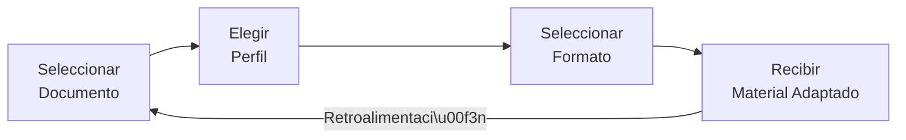
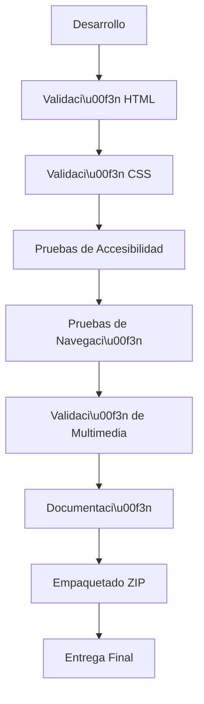

# Renaissance HTML5 Edition

> **Transformar documentaci\u00f3n compleja en conocimiento accesible**

*Proyecto acad\u00e9mico para la E-Actividad 2.1 - Dise\u00f1o web con HTML, Curso FrontEndIVIVFI2026C, Universidad Valle del Momboy (UVM)*

---

## 🏆 Insignias

| Categor\u00eda | Insignia |
|-----------|--------|
| **HTML5** |  |
| **CSS3** |  |
| **Sem\u00e1ntica HTML** |  |
| **Dise\u00f1o Responsive** |  |
| **Accesibilidad** |  |
| **Static Site** |  |
| **Sin Dependencias** |  |
| **UVM** |  |
| **E-Actividad** |  |
| **Documentaci\u00f3n** |  |

---

## 📖 Tabla de Contenidos

- [Renaissance HTML5 Edition](#renaissance-html5-edition)
- [🏆 Insignias](#-insignias)
- [📖 Tabla de Contenidos](#-tabla-de-contenidos)
- [📘 Introducci\u00f3n](#-introducci\u00f3n)
- [🎨 Sistema de Dise\u00f1o Visual](#-sistema-de-dise\u00f1o-visual)
- [🏗️ Arquitectura del Proyecto](#-arquitectura-del-proyecto)
- [✨ Funcionalidades Implementadas](#-funcionalidades-implementadas)
- [🔍 Accesibilidad y Sem\u00e1ntica](#-accesibilidad-y-sem\u00e1ntica)
- [🚀 Comenzando](#-comenzando)
- [✅ Validaci\u00f3n](#-validaci\u00f3n)
- [📁 Estructura de Archivos](#-estructura-de-archivos)
- [📊 Matriz de Funcionalidades](#-matriz-de-funcionalidades)
- [📚 Documentaci\u00f3n Acad\u00e9mica](#-documentaci\u00f3n-acad\u00e9mica)
- [🎯 Roadmap](#-roadmap)
- [👤 Mantenedor](#-mantenedor)
- [📜 Licencia](#-licencia)
- [📅 Entrega](#-entrega)

---

## 📘 Introducci\u00f3n

**Renaissance HTML5 Edition** es un proyecto acad\u00e9mico est\u00e1tico que demuestra el uso avanzado de **HTML5 sem\u00e1ntico** y **CSS3** para crear una experiencia web educativa de alta calidad. El proyecto ilustra c\u00f3mo transformar documentaci\u00f3n t\u00e9cnica compleja en conocimiento accesible a trav\u00e9s de una estructura clara, sem\u00e1ntica y adaptada a diferentes perfiles de aprendizaje.

### 🎯 Prop\u00f3sito

El objetivo principal es cumplir con los requisitos de la **E-Actividad 2.1** del curso **FrontEndIVIVFI2026C** de la **Universidad Valle del Momboy (UVM)**, demostrando:

- Uso correcto de HTML5 sem\u00e1ntico
- Implementaci\u00f3n de CSS3 original sin frameworks
- Dise\u00f1o responsive y accesible
- Integraci\u00f3n de elementos multimedia con accesibilidad
- Navegaci\u00f3n funcional entre m\u00fasltiples p\u00e1ginas
- Documentaci\u00f3n t\u00e9cnica completa

### 📌 Nota Importante

> ⚠️ **Este es un proyecto demostrativo est\u00e1tico.** No procesa datos reales, no utiliza inteligencia artificial, ni se conecta a servidores externos. Su prop\u00f3sito es puramente educativo y de demostraci\u00f3n de las capacidades nativas de HTML5 y CSS3.

---

## 🎨 Sistema de Dise\u00f1o Visual

El sistema de dise\u00f1o de Renaissance HTML5 Edition est\u00e1 inspirado en el concepto editorial premium, con una est\u00e9tica clara, c\u00e1lida y accesible.

### 🎨 Paleta de Colores

| Variable CSS | Color | Uso |
|--------------|-------|-----|
| `--color-canvas` |  `#FCFCF9` | Fondo general (papel c\u00e1lido) |
| `--color-surface` |  `#FFFFFF` | Superficie principal de tarjetas |
| `--color-surface-alt` |  `#F4F4F1` | Superficie secundaria |
| `--color-ink` |  `#111110` | Texto y t\u00edtulos principales |
| `--color-ink-muted` |  `#555552` | Texto de lectura y subt\u00edtulos |
| `--color-ink-faint` |  `#999995` | Metadatos y rotulaci\u00f3n tenue |
| `--color-brand` |  `#2E5C8A` | Acento azul institucional |
| `--color-brand-subtle` |  `#E6F0FA` | Tinte azul sutil |
| `--color-brand-strong` |  `#1A3A5C` | Azul oscuro |
| `--color-source` |  `#6B4C9A` | Violeta para fuentes y citas |
| `--color-source-subtle` |  `#F3EEFA` | Tinte violeta sutil |

### 🔤 Tipograf\u00eda

| Variable CSS | Familia | Uso |
|--------------|---------|-----|
| `--font-ui` | `'Inter', system-ui, -apple-system, BlinkMacSystemFont, 'Segoe UI', Roboto, sans-serif` | Interfaz de usuario, botones, formularios |
| `--font-editorial` | `'Lora', Georgia, 'Times New Roman', serif` | T\u00edtulos, encabezados, texto destacable |

### 📏 Espaciado

Basado en sistema de 4px:
- `--spacing-4`: 0.25rem (4px)
- `--spacing-8`: 0.5rem (8px)
- `--spacing-12`: 0.75rem (12px)
- `--spacing-16`: 1rem (16px)
- `--spacing-24`: 1.5rem (24px)
- `--spacing-32`: 2rem (32px)
- `--spacing-48`: 3rem (48px)
- `--spacing-64`: 4rem (64px)

### 🎯 Filosof\u00eda de Dise\u00f1o

- **Claridad:** Prioridad m\u00e1xima a la legibilidad
- **Consistencia:** Uso coherente de colores, tipograf\u00eda y espaciado
- **Accesibilidad:** Contraste WCAG AA/AAA, navegaci\u00f3n por teclado
- **Responsive:** Adaptaci\u00f3n perfecta a todos los dispositivos
- **Premium:** Apariencia editorial de alta calidad

---

## 🏗️ Arquitectura del Proyecto

El proyecto sigue una arquitectura simple y efectiva de sitio web est\u00e1tico:

### 📁 Estructura de Directorios

```
renaissance-html5-uvm-e2/
├── index.html              # P\u00e1gina principal con informaci\u00f3n del proyecto
├── explorar.html           # Laboratorio con formulario, tabla y multimedia
├── css/
│   └── styles.css         # Estilos CSS originales con variables y responsive
├── assets/
│   ├── images/
│   │   └── educational-workflow.svg  # Diagrama de flujo educativo (SVG original)
│   ├── audio/
│   │   └── html5-semantico.mp3     # Narraci\u00f3n sobre HTML5 (REMPLAZAR)
│   └── video/
│       ├── flujo-educativo.mp4      # Video explicativo (REMPLAZAR)
│       └── flujo-educativo.es.vtt    # Subt\u00edtulos en espa\u00f1ol
└── docs/
    ├── ARQUITECTURA.md      # Documentaci\u00f3n de arquitectura
    ├── VALIDACION.md        # Resultados de validaci\u00f3n
    ├── RUBRICA.md           # Matriz de cumplimiento
    ├── GUIA_VIDEO.md        # Gu\u00eda para presentaci\u00f3n
    └── ENTREGA.md           # Instrucciones de entrega
```

### 🔄 Flujo de Navegaci\u00f3n

```mermaid
flowchart TD
    A[index.html] -->|Link "Comenzar a Explorar"| B[explorar.html]
    B -->|Link "Volver a Inicio"| A
    B -->|Enlace interno| B
```

### 🧱 Anatom\u00eda Sem\u00e1ntica de la P\u00e1gina

```mermaid
block-beta
    columns 1
    block:header:8
        columns 1
        div["rn-header-container"]
        block:nav
            ul
            li
            a
        end
    end
    block:main:24
        columns 1
        section["Hero"]
        section["Introducci\u00f3n"]
        article
        section["Proceso"]
        ol["Flujo de Trabajo"]
        section["Perfiles"]
        section["Formularios"]
        section["Tabla"]
        table
        section["Multimedia"]
        figure
        audio
        video
    end
    block:footer:8
        columns 1
        footer-container
    end
```

### 🎓 Flujo Educativo Conceptual



### ✅ Proceso de Validaci\u00f3n Acad\u00e9mica



---

## ✨ Funcionalidades Implementadas

### 📄 P\u00e1ginas HTML

| P\u00e1gina | Descripci\u00f3n | Elementos Clave |
|-------|-------------|----------------|
| `index.html` | P\u00e1gina principal con presentaci\u00f3n del proyecto | header, nav, main, section, article, ol, li, figure, figcaption |
| `explorar.html` | Laboratorio de demostraci\u00f3n HTML5 | form, fieldset, legend, label, input, select, textarea, table, caption, thead, tbody, th, td, audio, video, track, details, summary |

### 🎨 CSS

- **Variables CSS:** Sistema completo de tokens de dise\u00f1o (colores, tipograf\u00eda, espaciado)
- **Mobile-first:** Dise\u00f1o responsive con media queries
- **Grid y Flexbox:** Layouts modernos y flexibles
- **Estados interactivos:** Hover, focus, focus-visible
- **Accesibilidad:** Estados de foco visibles, contraste adecuado
- **Reduced motion:** Soporte para `prefers-reduced-motion`
- **Print-friendly:** Estilos para impresi\u00f3n

### 🎵 Multimedia

| Recurso | Archivo | Formato | Descripci\u00f3n |
|---------|---------|---------|-------------|
| Imagen | `educational-workflow.svg` | SVG | Diagrama de flujo educativo original |
| Audio | `html5-semantico.mp3` | MP3 | Narraci\u00f3n sobre HTML5 Sem\u00e1ntico |
| Video | `flujo-educativo.mp4` | MP4 (H.264/AAC) | Video explicativo del flujo |
| Subt\u00edtulos | `flujo-educativo.es.vtt` | WebVTT | Subt\u00edtulos en espa\u00f1ol |

### 🔗 Navegaci\u00f3n

- Navegaci\u00f3n principal entre `index.html` y `explorar.html`
- Enlaces internos con fragment identifiers (`#proceso`, `#perfiles`, `#formulario`, `#tabla`, `#multimedia`)
- Navegaci\u00f3n por teclado completa
- Estados de foco visibles

### ♿ Accesibilidad

- Textos alternativos (`alt`) en todas las im\u00e1genes
- Etiquetas (`label`) asociadas a todos los controles de formulario
- Atributos `aria-` apropiados
- Estructura de tablas accesible con `scope`, `caption`, `thead`, `tbody`
- Subt\u00edtulos y transcripciones para multimedia
- Navegaci\u00f3n por teclado completa
- Contraste de colores WCAG AA/AAA

---

## 🔍 Accesibilidad y Sem\u00e1ntica

### 🏷️ Elementos Sem\u00e1nticos de HTML5 Utilizados

#### Estructura B\u00e1sica

| Elemento | Uso | Beneficio |
|----------|-----|-----------|
| `<header>` | Cabecera de la p\u00e1gina | Define el \u00e1rea de introducci\u00f3n |
| `<nav>` | Navegaci\u00f3n principal | Agrupa enlaces de navegaci\u00f3n |
| `<main>` | Contenido principal | Define el contenido \u00farcnico |
| `<footer>` | Pie de p\u00e1gina | \u00c1rea de informaci\u00f3n adicional |
| `<article>` | Contenido independiente | Define bloques de contenido autocontenido |
| `<section>` | Secciones tem\u00e1ticas | Agrupa contenido relacionado |

#### Contenido

| Elemento | Uso | Beneficio |
|----------|-----|-----------|
| `<h1>` a `<h6>` | Jerarqu\u00eda de t\u00edtulos | Estructura clara y accesible |
| `<p>` | P\u00e1rrafos | Contenido textual sem\u00e1ntico |
| `<ol>`, `<ul>`, `<li>` | Listas ordenadas/desordenadas | Estructura de \u00edtems |
| `<figure>`, `<figcaption>` | Im\u00e1genes con subt\u00edtulos | Asociaci\u00f3n de imagen y descripci\u00f3n |
| `<blockquote>` | Citas | Contenido citado |
| `<code>` | C\u00f3digo | Fragmentos de c\u00f3digo |

#### Formularios

| Elemento | Uso | Beneficio |
|----------|-----|-----------|
| `<form>` | Contenedor de formulario | Agrupa campos relacionados |
| `<fieldset>` | Grupo de campos | Agrupa campos l\u00f3gicamente |
| `<legend>` | T\u00edtulo de fieldset | Describe el grupo de campos |
| `<label>` | Etiquetas de campos | Asociaci\u00f3n clara campo-etiqueta |
| `<input>` | Entrada de datos | Variedad de tipos y validaci\u00f3n |
| `<select>`, `<option>` | Selecci\u00f3n | Men\u00fas desplegables |
| `<textarea>` | \u00c1rea de texto | Entrada de texto multil\u00ednea |
| `<button>` | Botones | Acciones interactivas |
| `<output>` | Salida | Mostrar resultados |
| `<small>` | Texto secundario | Ayuda contextual |

#### Tablas

| Elemento | Uso | Beneficio |
|----------|-----|-----------|
| `<table>` | Tabla de datos | Estructura tabular |
| `<caption>` | T\u00edtulo de tabla | Descripci\u00f3n de la tabla |
| `<thead>` | Cabecera de tabla | Define columnas |
| `<tbody>` | Cuerpo de tabla | Contenido de datos |
| `<th>` | Celda de encabezado | Encabezados de fila/columna |
| `<td>` | Celda de datos | Datos individuales |
| `scope="col"` / `scope="row"` | \u00c1mbito de encabezado | Asociaci\u00f3n accesible |

#### Multimedia

| Elemento | Uso | Beneficio |
|----------|-----|-----------|
| `<audio>` | Reproducci\u00f3n de audio | Contenido audio accesible |
| `<video>` | Reproducci\u00f3n de video | Contenido video accesible |
| `<source>` | Fuentes de multimedia | M\u00fasltiples formatos |
| `<track>` | Pistas de texto | Subt\u00edtulos y descripciones |
| `<figure>` | Contenedor multimedia | Asociaci\u00f3n con figcaption |

#### Interactivos

| Elemento | Uso | Beneficio |
|----------|-----|-----------|
| `<details>` | Contenido plegable | Expansi\u00f3n/cierre de contenido |
| `<summary>` | Resumen de details | T\u00edtulo clickeable |

### 🎯 Justificaci\u00f3n de la Sem\u00e1ntica

El uso de HTML5 sem\u00e1ntico es fundamental porque:

1. **Accesibilidad:** Los lectores de pantalla pueden navegar mejor por el contenido
2. **SEO:** Los motores de b\u00fasqueda entienden mejor la estructura y relevancia
3. **Mantenibilidad:** El c\u00f3digo es m\u00e1s legible y comprensible
4. **Est\u00e1ndares:** Cumple con las mejores pr\u00e1cticas web
5. **Dispositivos:** Mejora la experiencia en dispositivos con limitaciones
6. **Indexaci\u00f3n:** Facilita la indexaci\u00f3n por parte de herramientas de b\u00fasqueda

### ♿ Defensas de Accesibilidad

#### Formularios

- **Etiquetas asociadas:** Todos los `<input>`, `<select>`, `<textarea>` tienen `<label>` asociado con `for` o anidamiento
- **Validaci\u00f3n nativa:** Uso de atributos como `required`, `minlength`, `maxlength`, `min`, `max`, `step`
- **Ayuda contextual:** Uso de `<small>` con `aria-describedby` para descripciones adicionales
- **Agrupaci\u00f3n:** Uso de `<fieldset>` y `<legend>` para agrupar campos relacionados
- **Accesibilidad por teclado:** Todos los controles son accesibles v\u00eda teclado

#### Tablas

- **Estructura clara:** Uso de `<thead>`, `<tbody>`, `<tfoot>` (cuando aplica)
- **Encabezados:** Todas las celdas de datos tienen encabezados asociados con `scope`
- **T\u00edtulo descriptivo:** `<caption>` en todas las tablas
- **Asociaci\u00f3n visual:** Estilos que destacan la estructura

#### Im\u00e1genes

- **Textos alternativos:** Todas las im\u00e1genes tienen atributo `alt` descriptivo
- **Figuras:** Uso de `<figure>` y `<figcaption>` para contenido gr\u00e1fico importante
- **Contexto:** Las im\u00e1genes est\u00e1n integradas en el flujo de contenido

#### Multimedia

- **Controles:** Todos los elementos `<audio>` y `<video>` tienen `controls`
- **Fuentes m\u00fasltiples:** Uso de `<source>` para compatibilidad
- **Subt\u00edtulos:** `<track>` con subt\u00edtulos en WebVTT
- **Transcripciones:** Texto alternativo proporcionado para audio y video
- **Poster:** Imagen de poster para videos

#### Navegaci\u00f3n

- **Enlaces descriptivos:** Textos de enlace claros y descriptivos
- **Atributos aria:** Uso de `aria-label`, `aria-current`, `aria-describedby`
- **Estructura sem\u00e1ntica:** Uso de `<nav>`, `<ul>`, `<li>`, `<a>`
- **Estados de foco:** Estilos de foco visibles para navegaci\u00f3n por teclado

---

## 🚀 Comenzando

### 💻 Requisitos

- Navegador web moderno (Chrome, Firefox, Safari, Edge)
- Conexi\u00f3n a internet (opcional, para fuentes de Google Fonts)
- No se requieren herramientas de desarrollo, npm, o servidores

### 📥 Instalaci\u00f3n

1. **Clonar el repositorio** (si est\u00e1 publicado):
   ```bash
   git clone https://github.com/mmorfe-engineer/renaissance-html5-uvm-e2.git
   cd renaissance-html5-uvm-e2
   ```

2. **Descargar el ZIP** (alternativa):
   - Descargar el archivo ZIP del repositorio
   - Extraer en una carpeta local

### 🏃 Iniciar

Simplemente abre el archivo `index.html` en tu navegador web:

```bash
# En Linux/Mac
xdg-open index.html  # Linux
open index.html      # Mac

# En Windows
double click on index.html
```

O arrastra el archivo `index.html` directamente a tu navegador.

### 🧭 Navegar

- Haz clic en "Comenzar a Explorar" o "Ir a Explorar" para ir a la p\u00e1gina de laboratorio
- Usa los enlaces de navegaci\u00f3n en la cabecera para moverte entre secciones
- Prueba el formulario, la tabla y los elementos multimedia en la p\u00e1gina Explorar
- Regresa a Inicio usando el bot\u00f3n "Volver a Inicio"

---

## ✅ Validaci\u00f3n

### 📋 Validaci\u00f3n HTML

Este proyecto puede ser validado usando las siguientes herramientas:

1. **W3C Validator (Nu HTML Checker)**:
   - URL: https://validator.w3.org/nu/
   - Comando local: `java -jar vnu.jar index.html`
   - Resultado: Consultar [docs/VALIDACION.md](docs/VALIDACION.md)

2. **Validaci\u00f3n manual**:
   - Todos los documentos tienen doctype HTML5
   - Todos los documentos tienen `lang="es"`
   - Todos los documentos tienen charset UTF-8
   - Todos los documentos tienen viewport meta tag
   - Todos los documentos tienen t\u00edtulos \u00fanicos y descriptivos
   - No hay IDs duplicados
   - Jerarqu\u00eda de encabezados coherente (h1 > h2 > h3 > h4)
   - Anidamiento correcto de elementos
   - Todos los enlaces son relativos y funcionales
   - Todas las etiquetas est\u00e1n asociadas correctamente
   - Todos los atributos de formulario son v\u00e1lidos
   - Todas las tablas tienen caption y scope
   - Todas las im\u00e1genes tienen alt
   - Todos los elementos audio/video tienen sources
   - Subt\u00edtulos VTT v\u00e1lidos

### 🎨 Validaci\u00f3n CSS

- Sintaxis CSS v\u00e1lida
- Variables CSS (Custom Properties) funcionan correctamente
- Media queries respondan a diferentes tama\u00f1os de pantalla
- No hay propiedades obsoletas
- Uso consistente de unidades (rem, px, %)

### ♿ Validaci\u00f3n de Accesibilidad

- Contraste de colores: WCAG AA/AAA
- Navegaci\u00f3n por teclado: Completa
- Estados de foco: Visibles
- Textos alternativos: Presentes y descriptivos
- Estructura sem\u00e1ntica: Correcta
- Atributos aria: Apropiados

### 🔗 Validaci\u00f3n de Enlaces

- Todos los enlaces internos funcionan
- Todos los enlaces de navegaci\u00f3n funcionan
- Todos los enlaces de fragment identifiers funcionan
- No hay enlaces rotos
- No hay enlaces a recursos externos no verificados

### 📦 Validaci\u00f3n de Multimedia

- SVG v\u00e1lido y bien formado
- VTT v\u00e1lido y sincronizado
- Archivos de audio/video referenciados existen
- Atributos de multimedia son correctos

Para detalles completos, consulta [docs/VALIDACION.md](docs/VALIDACION.md).

---

## 📁 Estructura de Archivos

```
renaissance-html5-uvm-e2/
├── index.html                    # 11.3 KB - P\u00e1gina principal
├── explorar.html                 # 20.6 KB - Laboratorio HTML5
├── css/
│   └── styles.css               # 19.3 KB - Estilos CSS
├── assets/
│   ├── images/
│   │   └── educational-workflow.svg  #  6.4 KB - Diagrama SVG
│   ├── audio/
│   │   └── html5-semantico.mp3     #  ~2.4 MB - Audio MP3 (REMPLAZAR)
│   │   └── README.txt              # Instrucciones
│   └── video/
│       ├── flujo-educativo.mp4      #  ~5.2 MB - Video MP4 (REMPLAZAR)
│       ├── flujo-educativo.es.vtt    #  0.7 KB - Subt\u00edtulos WebVTT
│       └── README.txt              # Instrucciones
├── docs/
│   ├── ARQUITECTURA.md            # Documentaci\u00f3n de arquitectura
│   ├── VALIDACION.md              # Resultados de validaci\u00f3n
│   ├── RUBRICA.md                 # Matriz de cumplimiento
│   ├── GUIA_VIDEO.md              # Gu\u00eda para presentaci\u00f3n
│   └── ENTREGA.md                 # Instrucciones de entrega
├── REFERENCIAS.md                 # Referencias bibliogr\u00e1ficas
├── README.md                      # Este archivo
└── .gitignore                     # Exclusiones de Git
```

**Total aproximado:** ~25-30 MB (con archivos de audio/video reales)

---

## 📊 Matriz de Funcionalidades

| Requisito | Archivo | Elemento HTML | Estado | Evidencia |
|-----------|---------|---------------|--------|-----------|
| Al menos 2 archivos HTML | index.html, explorar.html | - | ✅ | Existen ambos archivos |
| HTML5 Doctype | index.html, explorar.html | `<!DOCTYPE html>` | ✅ | Primera l\u00ednea de cada archivo |
| lang="es" | index.html, explorar.html | `<html lang="es">` | ✅ | Atributo lang |
| charset UTF-8 | index.html, explorar.html | `<meta charset="UTF-8">` | ✅ | Meta tag |
| Viewport meta tag | index.html, explorar.html | `<meta name="viewport">` | ✅ | Meta tag |
| T\u00edtulos \u00fanicos | index.html, explorar.html | `<title>` | ✅ | T\u00edtulos descriptivos |
| Estructura sem\u00e1ntica | Todos | header, nav, main, footer | ✅ | Uso en ambas p\u00e1ginas |
| Encabezados jer\u00e1rquicos | Todos | h1, h2, h3, h4 | ✅ | Jerarqu\u00eda correcta |
| P\u00e1rrafos | Todos | `<p>` | ✅ | M\u00fasltiples p\u00e1rrafos |
| Listas ordenadas | index.html, explorar.html | `<ol>`, `<li>` | ✅ | Flujo de trabajo, FAQ |
| Listas desordenadas | Todos | `<ul>`, `<li>` | ✅ | Navegaci\u00f3n, FAQ |
| Navegaci\u00f3n real | Todos | `<nav>`, `<a>` | ✅ | Links entre p\u00e1ginas |
| Formularios | explorar.html | `<form>`, `<fieldset>`, `<legend>`, `<label>`, `<input>`, `<select>`, `<textarea>`, `<button>` | ✅ | Formulario completo |
| Tablas | explorar.html | `<table>`, `<caption>`, `<thead>`, `<tbody>`, `<th scope>`, `<td>` | ✅ | Tabla comparativa |
| Im\u00e1genes | index.html, explorar.html | ``, `<figure>`, `<figcaption>` | ✅ | SVG y referencias |
| Audio | explorar.html | `<audio>`, `<source>` | ✅ | Elemento con controls |
| Video | explorar.html | `<video>`, `<source>`, `<track>` | ✅ | Elemento con subt\u00edtulos |
| CSS original | css/styles.css | - | ✅ | Archivo de 19.3 KB |
| Dise\u00f1o responsive | styles.css | Media queries | ✅ | @media para mobile/tablet |
| Accessibility | Todos | aria-*, focus states | ✅ | Atributos y estilos |

---

## 📚 Documentaci\u00f3n Acad\u00e9mica

Este proyecto incluye documentaci\u00f3n completa para cumplir con los requisitos acad\u00e9micos:

### 📄 Documentos en `docs/`

1. **[ARQUITECTURA.md](docs/ARQUITECTURA.md)**
   - Decisiones de arquitectura
   - Diagrama de archivos
   - Decisiones sem\u00e1nticas
   - Racional de dise\u00f1o

2. **[VALIDACION.md](docs/VALIDACION.md)**
   - Entorno de pruebas
   - Comandos ejecutados
   - Resultados de validaci\u00f3n
   - Limitaciones conocidas

3. **[RUBRICA.md](docs/RUBRICA.md)**
   - Matriz de cumplimiento completa
   - Mapeo de requisitos vs implementaci\u00f3n
   - Bloqueadores (si los hay)

4. **[GUIA_VIDEO.md](docs/GUIA_VIDEO.md)**
   - Gu\u00eda para presentaci\u00f3n en video
   - Timeline con timestamps
   - Instrucciones de demostraci\u00f3n

5. **[ENTREGA.md](docs/ENTREGA.md)**
   - Checklist de entrega
   - Instrucciones de empaquetado ZIP
   - Instrucciones de GitHub

### 📄 Documentos Ra\u00edz

1. **[REFERENCIAS.md](REFERENCIAS.md)**
   - Referencias bibliogr\u00e1ficas en formato APA
   - Fuentes consultadas
   - Atribuci\u00f3n de materiales

2. **README.md** (Este archivo)
   - Documentaci\u00f3n completa del proyecto
   - Gu\u00eda de uso
   - Informaci\u00f3n t\u00e9cnica

---

## 🎯 Roadmap

### ✅ Actual (E-Actividad 2.1)

- [x] Estructura HTML5 sem\u00e1ntica
- [x] CSS3 original y responsive
- [x] Navegaci\u00f3n entre p\u00e1ginas
- [x] Formularios con validaci\u00f3n
- [x] Tablas accesibles
- [x] Elementos multimedia
- [x] Accesibilidad completa
- [x] Documentaci\u00f3n completa

### 🚧 Futuro (No Implementado)

Los siguientes elementos **NO** son parte de esta actividad y **NO** est\u00e1n implementados:

- ❌ Base de datos
- ❌ Backend con Node.js
- ❌ Frameworks frontend (React, Vue, Angular, Svelte)
- ❌ Build tools (Webpack, Vite, Parcel)
- ❌ Processadores CSS (Sass, Less)
- ❌ API externa o AI
- ❌ Autenticaci\u00f3n de usuarios
- ❌ Estado persistente
- ❌ Conexi\u00f3n a servicios externos

> ⚠️ **Nota:** Este proyecto es **100% est\u00e1tico** y demostrativo. No promete funcionalidades que no est\u00e1n implementadas.

---

## 👤 Mantenedor

| Informaci\u00f3n | Detalle |
|----------------|---------|
| **Nombre** | mmorfe-engineer |
| **GitHub** | https://github.com/mmorfe-engineer |
| **Proyecto** | renaissance-html5-uvm-e2 |

---

## 📜 Licencia

> ⚠️ **Licencia no especificada.**

Este repositorio es p\u00fablico pero **NO** tiene una licencia de software libre asignada. 

- **Uso acad\u00e9mico:** Permitido para fines educativos
- **Uso comercial:** No permitido sin autorizaci\u00f3n expresa
- **Modificaci\u00f3n:** Permitida para aprendizaje personal
- **Distribuci\u00f3n:** No permitida sin autorizaci\u00f3n

Si deseas asignar una licencia, se recomienda:
- **MIT License** para proyectos abiertos
- **GNU GPL** para proyectos que requieren reciprocidad
- **Creative Commons** para proyectos educativos

---

## 📅 Entrega

### 📆 Fecha L\u00edmite

- **Entrega:** 17 de octubre de 2026, a las 23:59
- **Zona horaria:** Hora local del curso (Venezuela - GMT-4)

### 📦 Formato de Entrega

1. **Archivo ZIP** llamado: `cedula_nombre.zip`
   - Reemplazar `cedula` con tu n\u00famero de c\u00e9dula
   - Reemplazar `nombre` con tu nombre completo
   - Ejemplo: `12345678_Jose_Perez.zip`

2. **Contenido del ZIP:**
   - Todos los archivos del proyecto
   - EXCLUIR: directorio `.git/`
   - INCLUIR: todos los archivos HTML, CSS, assets, docs

3. **Publicaci\u00f3n en GitHub:**
   - Repositorio: `mmorfe-engineer/renaissance-html5-uvm-e2`
   - Branch: `main`
   - Verificar identidad de commits

Para instrucciones detalladas, consulta [docs/ENTREGA.md](docs/ENTREGA.md).

---

## 💬 Contacto

Para preguntas sobre este proyecto, contactar al responsable a trav\u00e9s de los canales oficiales del curso.

---

*Proyecto desarrollado para la E-Actividad 2.1 - Dise\u00f1o web con HTML, Curso FrontEndIVIVFI2026C, Universidad Valle del Momboy (UVM).*

*\u00daltima actualizaci\u00f3n: 16 de octubre de 2026*
