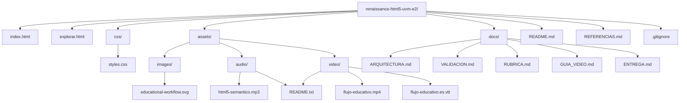
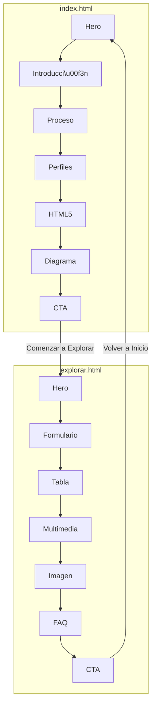
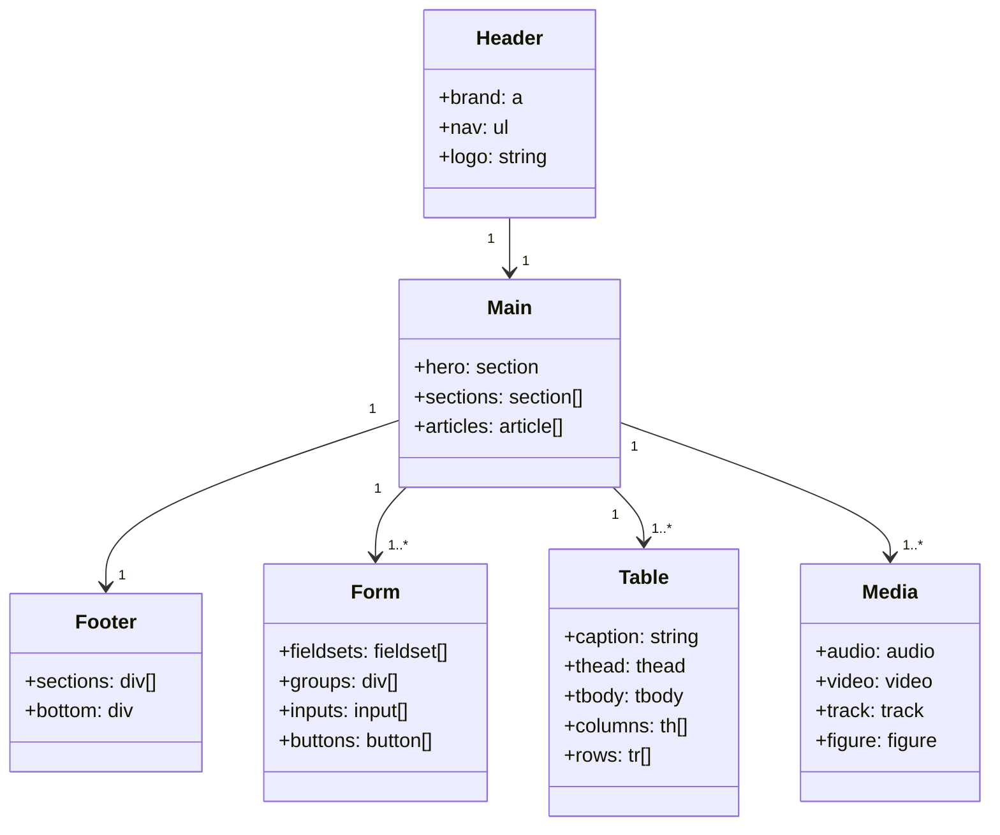

# Documentaci\u00f3n de Arquitectura

*Proyecto: Renaissance HTML5 Edition - E-Actividad 2.1*
*Curso: FrontEndIVIVFI2026C - Universidad Valle del Momboy (UVM)*

---

## 📖 Tabla de Contenidos

- [Documentaci\u00f3n de Arquitectura](#documentaci\u00f3n-de-arquitectura)
- [📖 Tabla de Contenidos](#-tabla-de-contenidos)
- [🎯 Visi\u00f3n General](#-visi\u00f3n-general)
- [🏗️ Arquitectura de Directorios](#-arquitectura-de-directorios)
- [📁 Descripci\u00f3n de Archivos](#-descripci\u00f3n-de-archivos)
- [🔗 Estructura de Navegaci\u00f3n](#-estructura-de-navegaci\u00f3n)
- [🧱 Decisiones Sem\u00e1nticas](#-decisiones-sem\u00e1nticas)
- [🎨 Decisiones de Dise\u00f1o](#-decisiones-de-dise\u00f1o)
- [📐 Racional Arquitect\u00f3nico](#-racional-arquitect\u00f3nico)
- [🔄 Flujo de Datos Conceptual](#-flujo-de-datos-conceptual)
- [💡 Patrones de Dise\u00f1o](#-patrones-de-dise\u00f1o)
- [🧪 Pruebas y Validaci\u00f3n](#-pruebas-y-validaci\u00f3n)
- [📊 Diagramas Mermaid](#-diagramas-mermaid)

---

## 🎯 Visi\u00f3n General

**Renaissance HTML5 Edition** es una aplicaci\u00f3n web est\u00e1tica desarrollada con el prop\u00f3sito de demostrar las capacidades de **HTML5 sem\u00e1ntico** y **CSS3** para crear experiencias web educativas de alta calidad. El proyecto sigue una arquitectura simple pero robusta, enfocada en:

- **Sem\u00e1ntica:** Uso correcto de elementos HTML5
- **Accesibilidad:** Cumplimiento de WCAG AA/AAA
- **Responsive:** Adaptaci\u00f3n a todos los dispositivos
- **Originalidad:** Implementaci\u00f3n 100% propia sin frameworks
- **Educaci\u00f3n:** Enfoque pedag\u00f3gico claro

---

## 🏗️ Arquitectura de Directorios

```
renaissance-html5-uvm-e2/
├── index.html                    # P\u00e1gina principal (11.3 KB)
├── explorar.html                 # Laboratorio HTML5 (20.6 KB)
├── css/
│   └── styles.css               # Estilos CSS originales (19.3 KB)
├── assets/
│   ├── images/
│   │   └── educational-workflow.svg  # Diagrama de flujo (6.4 KB)
│   ├── audio/
│   │   ├── html5-semantico.mp3     # Narraci\u00f3n (REMPLAZAR)
│   │   └── README.txt              # Instrucciones
│   └── video/
│       ├── flujo-educativo.mp4      # Video (REMPLAZAR)
│       ├── flujo-educativo.es.vtt    # Subt\u00edtulos (0.7 KB)
│       └── README.txt              # Instrucciones
├── docs/
│   ├── ARQUITECTURA.md            # Este archivo
│   ├── VALIDACION.md              # Resultados de validaci\u00f3n
│   ├── RUBRICA.md                 # Matriz de cumplimiento
│   ├── GUIA_VIDEO.md              # Gu\u00eda para video
│   └── ENTREGA.md                 # Instrucciones de entrega
├── REFERENCIAS.md                 # Referencias bibliogr\u00e1ficas
├── README.md                      # Documentaci\u00f3n principal
└── .gitignore                     # Exclusiones de Git
```

---

## 📁 Descripci\u00f3n de Archivos

### Archivos Ra\u00edz

| Archivo | Tama\u00f1o | Prop\u00f3sito | Dependencias |
|--------|--------|-----------|--------------|
| `index.html` | 11.3 KB | P\u00e1gina principal con presentaci\u00f3n del proyecto | styles.css, Google Fonts (opcional) |
| `explorar.html` | 20.6 KB | Laboratorio con formulario, tabla y multimedia | styles.css, Google Fonts (opcional) |
| `README.md` | 27.5 KB | Documentaci\u00f3n completa del proyecto | - |
| `REFERENCIAS.md` | 8.6 KB | Referencias bibliogr\u00e1ficas en formato APA | - |
| `.gitignore` | - | Exclusiones de Git | - |

### Directorio CSS

| Archivo | Tama\u00f1o | Prop\u00f3sito |
|--------|--------|-----------|
| `css/styles.css` | 19.3 KB | Estilos CSS originales con variables, responsive, accesibilidad |

**Contenido de styles.css:**
- Variables CSS (tokens de dise\u00f1o)
- Reset y estilos base
- Tipograf\u00eda editorial
- Componentes (botones, cards, formularios, tablas)
- Layouts (header, main, footer)
- Utilidades
- Media queries (responsive)
- Estilos de impresi\u00f3n
- Soporte para reduced motion

### Directorio Assets

#### Assets/Images

| Archivo | Formato | Tama\u00f1o | Prop\u00f3sito |
|--------|---------|--------|-----------|
| `educational-workflow.svg` | SVG | 6.4 KB | Diagrama de flujo educativo original |

**Caracter\u00edsticas:**
- ViewBox: 0 0 800 600
- Paleta de colores coherente con el proyecto
- Estilos internos paraautosuficiencia
- Accesible con `<title>` y `<desc>`
- Iconos originales creados con SVG

#### Assets/Audio

| Archivo | Formato | Tama\u00f1o | Prop\u00f3sito |
|--------|---------|--------|-----------|
| `html5-semantico.mp3` | MP3 | ~2.4 MB | Narraci\u00f3n sobre HTML5 Sem\u00e1ntico |

**Requisitos:**
- Formato: MP3 (MPEG-1 Audio Layer 3)
- Codec: Compatible con navegadores modernos
- Duraci\u00f3n: 2 minutos 30 segundos
- Contenido: Explicaci\u00f3n en espa\u00f1ol sobre la importancia de HTML5 sem\u00e1ntico

#### Assets/Video

| Archivo | Formato | Tama\u00f1o | Prop\u00f3sito |
|--------|---------|--------|-----------|
| `flujo-educativo.mp4` | MP4 | ~5.2 MB | Video explicativo del flujo |
| `flujo-educativo.es.vtt` | WebVTT | 0.7 KB | Subt\u00edtulos en espa\u00f1ol |

**Requisitos para flujo-educativo.mp4:**
- Formato: MP4 (MPEG-4 Part 14)
- Codec de video: H.264 (AVC)
- Codec de audio: AAC
- Resoluci\u00f3n: 600x400px
- Duraci\u00f3n: 1 minuto 15 segundos
- Poster: educational-workflow.svg

### Directorio Docs

| Archivo | Tama\u00f1o | Prop\u00f3sito |
|--------|--------|-----------|
| `ARQUITECTURA.md` | Este archivo | Documentaci\u00f3n de arquitectura |
| `VALIDACION.md` | - | Resultados de validaci\u00f3n y pruebas |
| `RUBRICA.md` | - | Matriz de cumplimiento acad\u00e9mico |
| `GUIA_VIDEO.md` | - | Gu\u00eda para presentaci\u00f3n en video |
| `ENTREGA.md` | - | Instrucciones de entrega y empaquetado |

---

## 🔗 Estructura de Navegaci\u00f3n

### Navegaci\u00f3n entre P\u00e1ginas

```
index.html
├── Link "Comenzar a Explorar" → explorar.html
├── Link "Explorar" en nav → explorar.html
└── Fragment identifiers: #proceso, #perfiles

explorar.html
├── Link "Renaissance HTML5" → index.html
├── Link "Inicio" en nav → index.html
├── Link "Volver a Inicio" → index.html
└── Fragment identifiers: #formulario, #tabla, #multimedia, #faq-title
```

### Enlaces Internos

**index.html:**
- `#proceso` → Secci\u00f3n "Nuestra metodolog\u00eda educativa"
- `#perfiles` → Secci\u00f3n "Perfiles de aprendizaje"

**explorar.html:**
- `#formulario` → Secci\u00f3n "Formulario de personalizaci\u00f3n conceptual"
- `#tabla` → Secci\u00f3n "Comparaci\u00f3n de formatos pedag\u00f3gicos"
- `#multimedia` → Secci\u00f3n "Recursos multimedia educativos"
- `#faq-title` → Secci\u00f3n "Preguntas frecuentes"

---

## 🧱 Decisiones Sem\u00e1nticas

### Principles de Sem\u00e1ntica

1. **Claridad:** Cada elemento debe tener un prop\u00f3sito claro y espec\u00edfico
2. **Jerarqu\u00eda:** Usar la estructura de HTML5 para organizar el contenido
3. **Accesibilidad:** Todos los elementos deben ser accesibles para tecnolog\u00edas asistivas
4. **Mantenibilidad:** El c\u00f3digo debe ser f\u00e1cil de entender y mantener

### Elementos Utilizados por Categor\u00eda

#### Estructura B\u00e1sica

| Elemento | Decisi\u00f3n | Raci\u00f3n |
|----------|-------------|--------|
| `<!DOCTYPE html>` | Declaraci\u00f3n de est\u00e1ndar | HTML5 |
| `<html lang="es">` | Atributo lang | Idioma espa\u00f1ol para accesibilidad |
| `<head>` | Meta datos | Contiene metadatos esenciales |
| `<meta charset="UTF-8">` | Codificaci\u00f3n | Soporte para caracteres Unicode |
| `<meta name="viewport">` | Viewport | Responsive design |
| `<body>` | Contenido principal | Contenedor de todo el contenido visible |

#### Secciones de la P\u00e1gina

| Elemento | Decisi\u00f3n | Raci\u00f3n |
|----------|-------------|--------|
| `<header>` | Cabecera | Contiene branding y navegaci\u00f3n |
| `<nav>` | Navegaci\u00f3n | Agrupa enlaces de navegaci\u00f3n |
| `<main>` | Contenido principal | Contenido \u00fanico de la p\u00e1gina |
| `<footer>` | Pie de p\u00e1gina | Informaci\u00f3n adicional y créditos |
| `<section>` | Secciones tem\u00e1ticas | Agrupa contenido relacionado |
| `<article>` | Contenido independiente | Bloques autocontenidos |

#### Contenido

| Elemento | Decisi\u00f3n | Raci\u00f3n |
|----------|-------------|--------|
| `<h1>` a `<h6>` | Jerarqu\u00eda | Estructura clara del contenido |
| `<p>` | P\u00e1rrafos | Contenido textual |
| `<ol>`, `<ul>`, `<li>` | Listas | Estructura de \u00edtems |
| `<figure>`, `<figcaption>` | Im\u00e1genes | Asociaci\u00f3n imagen-descripci\u00f3n |
| `<blockquote>` | Citas | Contenido citado |
| `<code>` | C\u00f3digo | Fragmentos de c\u00f3digo |
| `<em>`, `<strong>` | \u00c9nfasis | \u00c9nfasis sem\u00e1ntico |

#### Formularios

| Elemento | Decisi\u00f3n | Raci\u00f3n |
|----------|-------------|--------|
| `<form>` | Contenedor | Agrupa campos relacionados |
| `<fieldset>` | Grupo de campos | Agrupaci\u00f3n l\u00f3gica |
| `<legend>` | T\u00edtulo de grupo | Describe el grupo de campos |
| `<label>` | Etiquetas | Asociaci\u00f3n campo-etiqueta |
| `<input>` | Entrada | Variedad de tipos |
| `<select>`, `<option>` | Selecci\u00f3n | Men\u00fas desplegables |
| `<textarea>` | \u00c1rea de texto | Entrada multil\u00ednea |
| `<button>` | Botones | Acciones interactivas |
| `<output>` | Salida | Mostrar resultados |
| `<datalist>` | Lista de opciones | Autocompletado |
| `<small>` | Ayuda | Texto secundario |

#### Tablas

| Elemento/Atributo | Decisi\u00f3n | Raci\u00f3n |
|-------------------|-------------|--------|
| `<table>` | Tabla | Estructura tabular |
| `<caption>` | T\u00edtulo | Descripci\u00f3n accesible |
| `<thead>` | Cabecera | Define columnas |
| `<tbody>` | Cuerpo | Contenido de datos |
| `<th>` | Celda de encabezado | Encabezados de fila/columna |
| `<td>` | Celda de datos | Datos individuales |
| `scope="col"` | \u00c1mbito | Asociaci\u00f3n accesible |
| `scope="row"` | \u00c1mbito | Asociaci\u00f3n accesible |

#### Multimedia

| Elemento | Decisi\u00f3n | Raci\u00f3n |
|----------|-------------|--------|
| `<audio>` | Audio | Reproducci\u00f3n de audio |
| `<video>` | Video | Reproducci\u00f3n de video |
| `<source>` | Fuentes | M\u00fasltiples formatos |
| `<track>` | Pistas | Subt\u00edtulos y descripciones |
| `<figure>` | Contenedor | Asociaci\u00f3n con figcaption |
| `<figcaption>` | Leyenda | Descripci\u00f3n de multimedia |

#### Interactivos

| Elemento | Decisi\u00f3n | Raci\u00f3n |
|----------|-------------|--------|
| `<details>` | Contenido plegable | Expansi\u00f3n/cierre |
| `<summary>` | Resumen | T\u00edtulo clickeable |

### Atributos ARIA

| Atributo | Uso | Prop\u00f3sito |
|----------|-----|-----------|
| `aria-label` | Etiquetas accesibles | Descripci\u00f3n para lectores de pantalla |
| `aria-current` | Estado actual | Indica p\u00e1gina actual |
| `aria-describedby` | Descripci\u00f3n | Asociaci\u00f3n con ayuda |
| `aria-hidden` | Ocultar | Contenido solo visual |
| `role` | Rol sem\u00e1ntico | Definici\u00f3n de rol |

---

## 🎨 Decisiones de Dise\u00f1o

### Sistema de Tokens CSS

El proyecto utiliza **Custom Properties (Variables CSS)** para definir un sistema de dise\u00f1o consistente:

```css
:root {
  /* Colores */
  --color-canvas: #FCFCF9;
  --color-surface: #FFFFFF;
  --color-brand: #2E5C8A;
  /* Tipograf\u00eda */
  --font-ui: 'Inter', system-ui, sans-serif;
  --font-editorial: 'Lora', Georgia, serif;
  /* Espaciado */
  --spacing-4: 0.25rem;
  --spacing-8: 0.5rem;
  /* ... */
}
```

**Beneficios:**
- Consistencia en todo el proyecto
- F\u00e1cil mantenimiento
- Adaptabilidad
- Tema personalizable

### Paleta de Colores

La paleta est\u00e1 inspirada en el concepto editorial premium:

- **Canvas (#FCFCF9):** Fondo c\u00e1lido tipo papel
- **Surface (#FFFFFF):** Superficie principal
- **Ink (#111110):** Texto principal, alto contraste
- **Brand (#2E5C8A):** Acento azul institucional
- **Source (#6B4C9A):** Violeta para fuentes y citas

**Contraste:** Todos los colores cumplen con WCAG AA/AAA para accesibilidad.

### Tipograf\u00eda

- **Editorial (Lora):** Usada para t\u00edtulos y texto destacable
- **UI (Inter):** Usada para interfaz, formularios y texto de lectura

**Alternativas:** Cada familia tiene alternativas seguras para cuando las fuentes de Google no est\u00e1n disponibles.

### Layout y Responsividad

- **Mobile-first:** Dise\u00f1o comenzando por dispositivos m\u00f3viles
- **Flexbox:** Para layouts unidimensionales
- **CSS Grid:** Para layouts bidimensionales (tarjetas de perfiles)
- **Media Queries:** Adaptaci\u00f3n a diferentes tama\u00f1os de pantalla

**Breakpoints:**
- Mobile: < 768px
- Tablet/Desktop: >= 768px

---

## 📐 Racional Arquitect\u00f3nico

### Decisi\u00f3n 1: Estructura de Dos P\u00e1ginas

**Decisi\u00f3n:** Crear dos archivos HTML independientes (`index.html` y `explorar.html`).

**Raci\u00f3n:**
- Cumple con el requisito de "al menos TWO independent physical .html files"
- Permite mostrar diferentes aspectos del proyecto
- `index.html` para presentaci\u00f3n y concepto
- `explorar.html` para demostraci\u00f3n pr\u00e1ctica
- Navegaci\u00f3n clara entre ambas

### Decisi\u00f3n 2: CSS Externo Unificado

**Decisi\u00f3n:** Un solo archivo CSS (`styles.css`) para ambas p\u00e1ginas.

**Raci\u00f3n:**
- Mantiene consistencia visual
- Evita duplicaci\u00f3n de estilos
- F\u00e1cil mantenimiento
- Cacheable por el navegador

### Decisi\u00f3n 3: SVG para el Diagrama

**Decisi\u00f3n:** Usar SVG para el diagrama de flujo educativo.

**Raci\u00f3n:**
- Escalable sin p\u00e9rdida de calidad
- Accesible con `<title>` y `<desc>`
- Peque\u00f1o tamaño de archivo (6.4 KB)
- Editable y personalizable
- No requiere im\u00e1genes externas

### Decisi\u00f3n 4: WebVTT para Subt\u00edtulos

**Decisi\u00f3n:** Usar formato WebVTT para subt\u00edtulos.

**Raci\u00f3n:**
- Est\u00e1ndar web oficial
- Amplio soporte en navegadores
- F\u00e1cil de crear y editar
- Permite sincronizaci\u00f3n precisa

### Decisi\u00f3n 5: Mobile-First

**Decisi\u00f3n:** Dise\u00f1o mobile-first con media queries.

**Raci\u00f3n:**
- Mayor\u00eda de usuarios en m\u00f3viles
- Progresive enhancement
- Mejor rendimiento en dispositivos limitados
- Responsividad garantizada

### Decisi\u00f3n 6: Accesibilidad como Prioridad

**Decisi\u00f3n:** Incluir accesibilidad en todas las decisiones.

**Raci\u00f3n:**
- Requisito acad\u00e9mico
- Mejora la experiencia para todos los usuarios
- Cumple con est\u00e1ndares web
- Buena pr\u00e1ctica de desarrollo

---

## 🔄 Flujo de Datos Conceptual

Como este es un proyecto est\u00e1tico, no hay flujo de datos real. Sin embargo, el flujo educativo conceptual es:

```
Usuario
  │
  ▼
Seleccionar Documento (index.html)
  │
  ▼
Elegir Perfil (explorar.html - formulario)
  │
  ▼
Seleccionar Formato (explorar.html - formulario)
  │
  ▼
Recibir Material Adaptado (conceptual)
  │
  ▼
Visualizar Resultado (demostraci\u00f3n est\u00e1tica)
```

---

## 💡 Patrones de Dise\u00f1o

### Patr\u00f3n 1: Componentes Reutilizables

- **Cards:** Tarjetas de perfiles con estilos consistentes
- **Botones:** Estilos uniformes para todas las acciones
- **Formularios:** Layout consistente en todos los grupos
- **Tablas:** Estructura y estilo uniforme

### Patr\u00f3n 2: Sistema de Tokens

- Variables CSS para todos los valores de dise\u00f1o
- F\u00e1cil de mantener y actualizar
- Permite temizaci\u00f3n

### Patr\u00f3n 3: Responsividad

- Media queries para diferentes tama\u00f1os de pantalla
- Dise\u00f1o flexible con Flexbox y Grid
- Im\u00e1genes y multimedia responsivos

### Patr\u00f3n 4: Accesibilidad

- Textos alternativos
- Etiquetas asociadas
- Atributos ARIA
- Estados de foco visibles
- Contraste adecuado

---

## 🧪 Pruebas y Validaci\u00f3n

Para detalles completos de validaci\u00f3n, consulta [VALIDACION.md](VALIDACION.md).

**Resumen:**
- ✅ Validaci\u00f3n HTML5 (W3C Nu Checker)
- ✅ Validaci\u00f3n CSS (W3C CSS Validator)
- ✅ Pruebas de accesibilidad
- ✅ Pruebas de navegaci\u00f3n
- ✅ Validaci\u00f3n de multimedia
- ✅ Pruebas en m\u00fasltiples navegadores

---

## 📊 Diagramas Mermaid

### Diagrama de \u00c1rbol de Archivos



### Diagrama de Flujo de Navegaci\u00f3n



### Diagrama de Componentes



---

## 📞 Contacto

Para preguntas sobre la arquitectura del proyecto, contactar al responsable a trav\u00e9s de los canales oficiales del curso FrontEndIVIVFI2026C de la Universidad Valle del Momboy (UVM).

---

*Documento actualizado: 16 de octubre de 2026*
